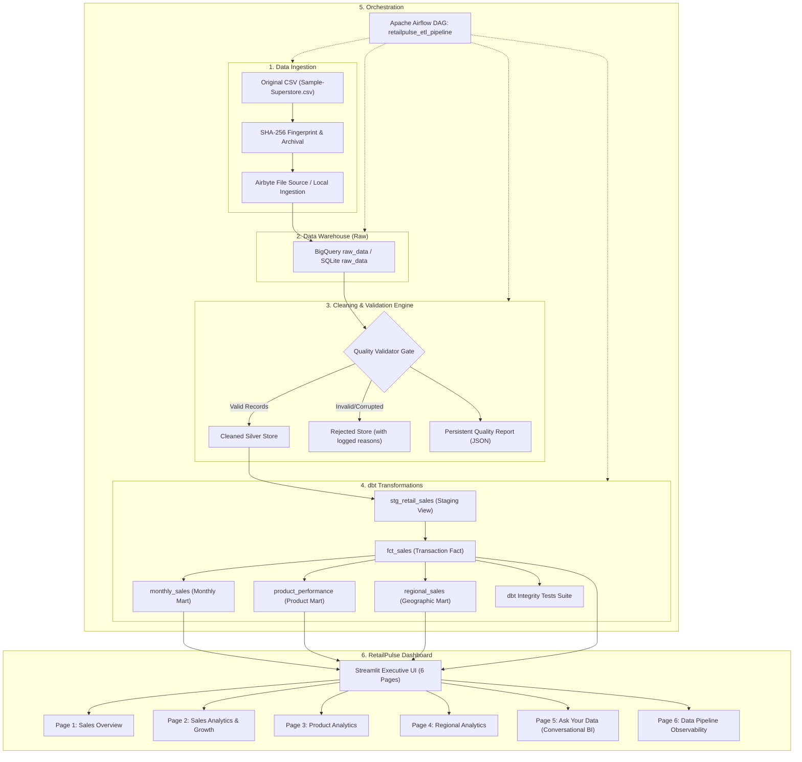

# 🛍️ RetailPulse – Retail Sales Analytics & Automated Data Pipeline
**Retail Intelligence Platform & Automated Data Engineering Architecture**


---

## 📌 Executive Summary

**RetailPulse** is an enterprise-grade, end-to-end Data Engineering and Business Intelligence platform built to ingest, validate, store, transform, orchestrate, and visualize retail sales data. 

Using the authentic **Sample Superstore Sales Dataset** (~1,000 representative records preserved alongside the untouched raw dataset), the system provides automated ELT workflows, audit logs, persistent run history, dbt dimensional marts, an Apache Airflow DAG, and a premium 6-page SaaS Streamlit dashboard with conversational Natural Language BI.

---

## 🏗️ System Architecture



---

## 🎨 Design System & Color Palette

The user interface follows a modern cream-and-navy executive theme:
- **Background (`#F7F5EF`)**: Premium cream matte surface.
- **Sidebar (`#142B3B`)**: Midnight navy sidebar with subtle borders.
- **Primary Accent (`#287D6B`)**: Muted emerald teal highlights.
- **Secondary Accent (`#C6A568`)**: Warm artisan gold accents.
- **Cards (`#FFFEFA`)**: Soft ivory card surface with rounded corners (`12px`) and subtle shadows.
- **Text (`#263746`)**: Charcoal slate for readability.
- **Dark Mode**: Fully supported via an instant toggle in the sidebar (`#0F1A24` base).

---

## 📂 Repository Structure

```
RetailPulse/
├── data/
│   ├── raw/
│   │   ├── Sample-Superstore.csv           # Preserved original dataset
│   │   └── superstore_sample_1000.csv      # Representative 1,000-record sample
│   ├── processed/
│   │   ├── latest_cleaned_sales.csv        # Cleaned dataset
│   │   └── cleaned_sales_<timestamp>.csv   # Historical clean snapshots
│   ├── rejected/
│   │   ├── latest_rejected_records.csv     # Records rejected with audit reason
│   │   └── rejected_records_<timestamp>.csv
│   ├── archive/
│   │   └── raw_snapshot_<timestamp>.csv    # Raw ingestion snapshots
│   ├── reports/
│   │   ├── data_profiling_report.json      # Initial profiling report
│   │   ├── data_profiling_report.md
│   │   └── latest_quality_report.json      # Runtime data quality report
│   └── retailpulse.db                      # Persistent SQLite warehouse & history
├── ingestion/
│   └── airbyte_config.json                 # Airbyte File Source & BQ Destination config
├── dbt_retailpulse/
│   ├── dbt_project.yml                     # dbt configuration
│   ├── profiles.yml                        # BigQuery & local connection profiles
│   ├── models/
│   │   ├── sources.yml                     # Raw table definitions
│   │   ├── schema.yml                      # Model documentation & generic tests
│   │   ├── staging/
│   │   │   └── stg_retail_sales.sql        # Staging view
│   │   └── marts/
│   │       ├── fct_sales.sql               # Fact table with profit tiers
│   │       ├── monthly_sales.sql           # Monthly revenue and AOV mart
│   │       ├── product_performance.sql     # Product ranking & margins mart
│   │       └── regional_sales.sql          # State and territory performance mart
│   └── tests/
│       ├── assert_positive_sales.sql       # Singular test: non-positive sales
│       └── assert_positive_quantity.sql    # Singular test: non-positive quantities
├── airflow/
│   └── dags/
│       └── retailpulse_etl_pipeline.py     # End-to-end Airflow DAG
├── dashboard/
│   ├── pages/
│   │   ├── page_1_sales_overview.py        # Executive macro KPIs & trends
│   │   ├── page_2_sales_analytics.py       # Daily/monthly velocity & MoM growth
│   │   ├── page_3_product_analytics.py     # Product quadrant & sub-categories
│   │   ├── page_4_regional_analytics.py    # Geographic US map & state rankings
│   │   ├── page_5_ask_your_data.py         # Natural Language Conversational BI
│   │   └── page_6_data_pipeline.py         # Pipeline monitoring, DAG & controls
│   └── utils/
│       ├── theme.py                        # Brand CSS injection & Plotly templates
│       └── bi_query_engine.py              # Semantic NLP to SQL query engine
├── pipeline/
│   ├── db_manager.py                       # SQLite schema & persistent history
│   ├── bigquery_client.py                  # Google BigQuery warehouse client
│   ├── cleaner_validator.py                # Validation engine (nulls, duplicates, dates)
│   ├── ingestion.py                        # Idempotent ingestion & SHA-256 hashing
│   ├── dbt_runner.py                       # dbt SQL runner & automated test suite
│   └── pipeline_engine.py                  # End-to-end pipeline orchestrator & mutex lock
├── scripts/
│   └── profile_and_sample.py               # Dataset profiling & 1,000-sample generator
├── tests/
│   └── test_pipeline.py                    # Unit & integration test suite
├── app.py                                  # Streamlit application entrypoint
├── config.py                               # Global configuration & paths
├── docker-compose.yml                      # Airflow & Postgres local orchestration
├── requirements.txt                        # Python dependencies
├── .env.example                            # Cloud credentials template
└── README.md                               # Project documentation
```

---

## ⚡ Quickstart & Installation

### 1. Prerequisites
- Python 3.10 or higher installed
- Git installed
- *(Optional)* Docker Desktop (for Airbyte / Apache Airflow)
- *(Optional)* Google Cloud Platform service account key (for BigQuery)

### 2. Install Dependencies
```bash
# Clone or navigate to the repository
cd "Retail Pulse"

# Install required packages
pip install -r requirements.txt
```

### 3. Launch the Streamlit Dashboard
```bash
streamlit run app.py
```
Open [http://localhost:8501](http://localhost:8501) in your browser.

---

## 🛠️ Step-by-Step Architecture Walkthrough

### 1. Data Ingestion & Idempotency
- Reads the dataset from `data/raw/`.
- Computes a SHA-256 fingerprint of the input file.
- Archives a timestamped snapshot in `data/archive/raw_snapshot_<timestamp>.csv`.
- Avoids duplicate ingestion if identical file hashes have been processed.
- Connects to Airbyte when running or directly ingests into `raw_data` with metadata tracking (`_ingested_at`, `_run_id`).

### 2. Cleaning & Validation Engine
Validates records across 5 critical dimensions:
1. **Critical Missing Values:** Flags rows missing `Order ID`, `Customer ID`, `Sales`, `Quantity`, or `Category`.
2. **Duplicate Detection:** Identifies exact duplicate rows without double-counting.
3. **Invalid Dates & Chronology:** Validates date formatting (`YYYY-MM-DD`) and ensures `Ship Date >= Order Date`.
4. **Numeric Constraints:** Enforces `Sales > 0`, `Quantity > 0`, and `0 <= Discount <= 1`.
5. **No Double-Counting Rule:** Treats `Sales` as line-item revenue (never re-multiplies by quantity).
Outputs:
- Clean dataset saved to `data/processed/latest_cleaned_sales.csv`.
- Rejected rows saved to `data/rejected/latest_rejected_records.csv` with explicit `rejection_reason`.
- Quality report saved to `data/reports/latest_quality_report.json`.

### 3. BigQuery & Persistent Storage
- Supports both **Google BigQuery** (cloud mode) and **SQLite** (local persistent mode).
- Keeps `raw_data` and `analytics` datasets completely separated.
- When credentials are not provided, it runs locally without faking cloud syncs.

### 4. dbt Transformations & Integrity Tests
- **`stg_retail_sales`**: Cleans and types columns, computes `order_year_month`, `order_quarter`, and `profit_margin_pct`.
- **`fct_sales`**: Fact table categorizing rows into `High Profit`, `Moderate Profit`, `Low Profit`, and `Loss`.
- **`monthly_sales`**: Monthly aggregated revenue, profit, units sold, and Average Order Value (AOV).
- **`product_performance`**: SKU-level revenue, profit margins, and `dense_rank()`.
- **`regional_sales`**: Territorial sales, order count, and state-level profitability.
- **Tests**: Validates positive quantities, positive sales, and unique row IDs.

### 5. Apache Airflow Orchestration
The DAG `retailpulse_etl_pipeline` coordinates:
```
start >> airbyte_sync >> data_validation >> dbt_run >> dbt_test >> bigquery_validation >> end
```
Includes retries (`retries=2`), timeout alarms, execution history logs, and a `docker-compose.yml` for local containerized deployment.

---

## 🎓 College Viva & Interview Guide

### Q1: What is the core difference between ETL and ELT in RetailPulse?
> **Answer:** RetailPulse uses an **ELT** (Extract, Load, Transform) pattern. Raw transaction data is extracted from the CSV/Airbyte source and loaded directly into the raw warehouse table (`raw_data`). Transformations, data standardization, and dimensional aggregations are then executed inside the warehouse using SQL (`dbt`), leveraging the database engine for maximum query performance.

### Q2: Why is `Sales` not multiplied by `Quantity` in the transformations?
> **Answer:** In the Superstore dataset, the `Sales` column already represents the total monetary revenue for that transaction line item (i.e. Unit Price × Quantity × (1 - Discount)). Multiplying `Sales` by `Quantity` again would severely distort financial metrics and overstate revenue by a factor of 3 to 10×.

### Q3: How does the pipeline ensure idempotency and prevent duplicate records?
> **Answer:** 
> 1. We compute a SHA-256 cryptographic hash of the input file before ingestion and check against the `ingestion_log` table.
> 2. The pipeline enforces a mutex lock (`.pipeline_lock`) to block accidental concurrent executions.
> 3. dbt models materialize as views/tables (`fct_sales`, `monthly_sales`) using deterministic primary keys (`row_id`) and `COUNT(DISTINCT order_id)` aggregations.

### Q4: How does the "Ask Your Data" Conversational BI work without hardcoding?
> **Answer:** The engine uses semantic keyword mapping to generate parameterized, syntax-validated SQL statements. It executes the query against live analytics tables, retrieves the actual dynamic figures (revenue, profits, SKUs), formats the answer, plots a responsive Plotly chart, and outputs the real SQL query for transparency.

### Q5: How are rejected records handled?
> **Answer:** Rather than silently discarding invalid rows, the validation engine routes failing records to `data/rejected/latest_rejected_records.csv`. Each record receives a dedicated `rejection_reason` column (e.g. `Missing critical attribute 'Sales'`), and the failure metrics are permanently stored in the quality audit log and displayed on the Data Pipeline page.

---

## 🧪 Running Automated Tests

Run the test suite using Python's standard `unittest` framework:
```bash
python tests/test_pipeline.py
```
Expected output:
```
Ran 6 tests in 0.295s
OK
```

---

## 📄 License
This project is developed for educational and enterprise data engineering demonstrations. Released under the MIT License.
# RetailSales-

